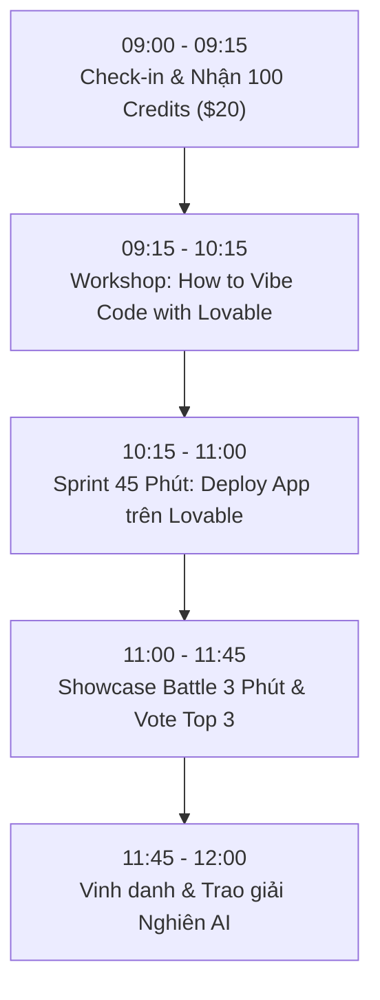

# CẨM NANG THỰC CHIẾN & HANDOVER: NGHIÊN CONNECT #6
## Chủ đề: "From Lovable to Buildable" | Nhóm 2: Vibe Code Sprint & Showcase Battle
*Dành riêng cho: Builder Mr.Híu — Dự án: HVN Financial Intelligence Platform*

---

### 1. TIMELINE CHI TIẾT & CHECKLIST HÀNH ĐỘNG BUỔI SÁNG (09:00 - 12:00)



#### 🔹 Giai đoạn 1: 09:00 - 09:15 (Check-in & Kích hoạt Tài nguyên)
- [ ] Nhận voucher 100 credits Lovable Pro ($20) từ BTC Nghiên AI.
- [ ] Mở trình duyệt đăng nhập tài khoản Lovable: [https://lovable.dev](https://lovable.dev).
- [ ] Kích hoạt kết nối **Lovable MCP Server**:
  - Tại terminal dự án cục bộ, chạy:
    ```bash
    npx -y mcp-remote https://mcp.lovable.dev
    ```
  - Khi trình duyệt bật lên, bấm **Authorize** để cấp quyền OAuth.

#### 🔹 Giai đoạn 2: 09:15 - 10:15 (Tư duy Vibe Code & Kiểm soát Prompt)
- [ ] Lắng nghe chia sẻ từ anh Khải Hoàn (Admin Nghiên AI) về tư duy kiểm soát code và prompt architecture.
- [ ] Chuẩn bị sẵn bộ prompt từ tài liệu: [`docs/architecture_lovable_spec.md`](file:///home/wane/Drive_F/phantichtcdn-main/docs/architecture_lovable_spec.md).

#### 🔹 Giai đoạn 3: 10:15 - 11:00 (Sprint 45 Phút — Xây dựng App trên Lovable)
Thực hiện theo 3 bước tuần tự (tránh prompt dàn trải làm cạn credit):

* **Bước 1 (10:15 - 10:30): Dựng Khung Giao diện & Executive KPI Dashboard**
  - *Prompt*: Copy **Prompt 1** ở Mục 2 bên dưới vào khung chat Lovable để dựng Dashboard tài chính chuẩn FactSet/Bloomberg với tone màu Dark Slate Navy, hiển thị các KPI: Doanh thu, EBIT, Vốn chủ sở hữu âm (-12,000 tỷ), Tỷ lệ Nợ/Vốn, Khả năng sinh tồn (Liquidity Runway).
* **Bước 2 (10:30 - 10:45): Tích hợp Sliders Mô phỏng Kịch bản Vĩ mô (Feature "Ăn tiền")**
  - *Prompt*: Copy **Prompt 2** để tích hợp 2 thanh trượt tương tác:
    - Giá dầu Jet A-1 ($70 - $140/thùng).
    - Tỷ giá USD/VND (24,000 - 27,000 VND).
    - Logic phản ứng: Khi kéo slider, EBIT và Điểm hòa vốn (Break-Even Point) tự động tính toán lại và biểu đồ cập nhật tức thời.
* **Bước 3 (10:45 - 10:55): Báo cáo Nghiên cứu & Kiểm định Thống kê (Tab 3 & 4)**
  - Tích hợp kết quả kiểm định chất lượng số liệu (ADF Test, Granger Causality, Sloan Accruals).
* **Bước 4 (10:55 - 11:00): Deploy Live & Lấy URL Demo**
  - Bấm **Deploy** trên Lovable để lấy link public (ví dụ: `https://hvn-financial-platform.lovable.app`).

#### 🔹 Giai đoạn 4: 11:00 - 11:45 (Showcase Battle 3 Phút & Vote)
- [ ] Mở sẵn tab Web App đã deploy và tab Antigravity IDE cục bộ.
- [ ] Trình bày theo kịch bản chuẩn trong file [`docs/SHOWCASE_PITCHING_3MINS.md`](file:///home/wane/Drive_F/phantichtcdn-main/docs/SHOWCASE_PITCHING_3MINS.md).

---

### 2. BỘ PROMPT CHUẨN ĐỂ SPRINT TRÊN LOVABLE (COPY-PASTE READY)

#### 📝 Prompt 1: Khởi tạo Executive Dashboard
```text
Build a high-end corporate financial intelligence platform for Vietnam Airlines (HVN).
Theme: Bloomberg / FactSet FinTech aesthetic with Tailwind CSS and dark slate navy palette (slate-900, zinc-100, emerald-500, rose-500).

Layout:
1. Header: "VIETNAM AIRLINES (HVN) — FINANCIAL INTELLIGENCE PLATFORM", Tag: "Enterprise Valuation & Macro Stress-Testing".
2. Top KPI Cards:
   - Revenue: 92,231 B VND (+12.4% YoY)
   - EBIT: 6,431 B VND (Turnaround positive)
   - Owner's Equity: -12,450 B VND (Negative Equity / Critical Capital Erosion)
   - DOL (Degree of Operating Leverage): 4.12x (High fixed cost structure)
   - Liquidity Runway: 8.4 Months (Cash + Short-term investments vs. Monthly burn rate)
3. Main Chart: Quarterly Revenue vs. Operating Profit (EBIT) bar/line chart with breakdown of Operating Expenses (Fuel Jet A-1, Aircraft Leasing, Personnel).
Include tab navigation: [Executive Dashboard], [Macro Stress-Testing Simulator], [Statistical Diagnostics], [Investment Thesis].
```

#### 📝 Prompt 2: Thêm Bộ Mô phỏng Stress-Testing (Macro Sliders)
```text
In the [Macro Stress-Testing Simulator] tab, build an interactive real-time sensitivity calculator:
1. Two dynamic sliders:
   - Jet A-1 Fuel Price: Min $70, Max $140, Step 1, Default $101/barrel.
   - USD/VND Exchange Rate: Min 24,000, Max 27,000, Step 50, Default 25,690 VND.
2. Real-time Calculation Logic:
   - Baseline Annual Fuel Consumption = 1.1 million tons (~8.2 million barrels).
   - Fuel Cost Impact = (Current Jet Price - 101) * 8.2M * Exchange Rate.
   - FX Impact on USD Debt (HVN holds ~$1.8B USD debt): FX Loss = Debt_USD * (Current FX - 25,690).
   - Dynamic EBIT = Baseline EBIT (6,431 B) - Fuel Impact - FX Impact.
   - Dynamic Break-even Load Factor (Ghế hòa vốn): Recalculate based on current fuel and fixed costs.
3. Display:
   - Dynamic Gauge / Alert Card showing: Projected EBIT and Solvency Warning level (Safe / Caution / Distress).
   - Waterfall chart showing EBIT erosion breakdown.
```

---

### 3. KỸ THUẬT VẬN HÀNH LOCAL QUANT ENGINE (NẾU CẦN ĐỐI SOÁT TẠI CHỖ)

Khi cần trích xuất số liệu mới nhất hoặc đối soát tại sự kiện:
```bash
# 1. Kích hoạt môi trường và cập nhật vĩ mô mới nhất
uv run python scripts/crawlers/macro_crawler.py

# 2. Chạy toàn bộ pipeline kiểm toán tài chính (chỉ mất ~1.6 giây)
PYTHONPATH=src uv run python src/pipeline_runner.py

# 3. Chạy dashboard Streamlit nội bộ dự phòng (nếu mạng yếu)
PYTHONPATH=src uv run streamlit run src/app.py --server.port 8501
```

---

### 4. ĐIỀU KHOẢN MIỄN TRỪ VÀ BẢO MẬT (DISCLAIMER)
- Toàn bộ dữ liệu sử dụng là dữ liệu công khai từ Báo cáo tài chính đã kiểm toán của Tổng công ty Hàng không Việt Nam (HVN) và dữ liệu vĩ mô mở (Yahoo Finance, ExchangeRate API).
- Hệ thống tuân thủ triệt để Zero-Trust: Không hardcode bất kỳ API key hay dữ liệu nội bộ bảo mật nào.
- Ứng dụng phục vụ hoàn toàn cho mục đích nghiên cứu học thuật, giáo dục định lượng và tham gia tranh tài công nghệ tại sự kiện **Nghiên Connect #6**.
